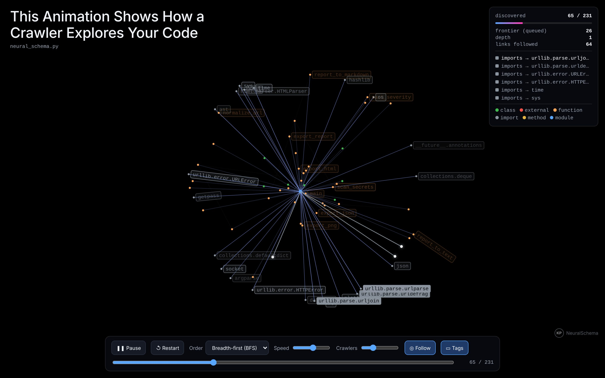

# NeuralSchema

Universal Code & System Architecture Analyzer.



> **New in 0.3 — Reverse Mode.** Drag & drop any `.exe`, `.dll`, ELF, `.so`,
> Mach-O, `.apk`, `.wasm`, `.gguf` or source file into the **Reverse Studio**
> (`--serve`), get an evidence pack any AI can read (`--export aipack`), or let
> any AI agent reverse files itself through the **MCP server** (`--mcp`).
> See [docs/REVERSE_MODE.md](docs/REVERSE_MODE.md).
>
> **0.2 — Crawl Mode.** Watch a crawler discover your code, your OS or
> a website node by node (BFS / DFS / real-crawl replay), as one offline HTML
> page. See [docs/CRAWL_MODE.md](docs/CRAWL_MODE.md).

Builds a "neural schema" (an architecture graph of nodes + relations) for:

1. **Source code** across many languages
   - Python (`.py`) — via the built-in `ast` module
   - C (`.c` `.h`) — via tree-sitter
   - C++ (`.cpp` `.hpp` ..) — via tree-sitter
   - Java (`.java`) — via tree-sitter
   - C# (`.cs`) — via tree-sitter
   - Shell (`.sh` `.bash`) — via tree-sitter (Bash / sh)

   Extracts modules, namespaces, classes/structs/interfaces, functions,
   methods, imports/includes, inheritance, and call-graph edges — for shell,
   also the external programs a script invokes.

2. **The operating system itself** (live introspection via `psutil`)
   - CPU / memory / disks / network interfaces / logged-in users and a
     process tree (parent → child) of the heaviest processes, with optional
     network-connection nodes.

The result can be:
- explored interactively in a Tkinter GUI (force-directed graph, click a node
  to inspect it and highlight its neighbours),
- exported to a self-contained interactive HTML page (works offline),
- exported to JSON (nodes + edges), or a PNG snapshot.

## Usage

```bash
# Launch the GUI (default when no analysis flags are given):
python3 neural_schema.py

# Command line -- analyse a file, a whole project folder, or the OS:
python3 neural_schema.py --file path/to/program.py
python3 neural_schema.py --file path/to/project_dir
python3 neural_schema.py --system --top 50

# Add exports (any combination), optionally with --no-gui to stay headless:
python3 neural_schema.py --file src/ --export html json png --out ./schema --no-gui
python3 neural_schema.py --system --connections --export html --no-gui
```

### Reverse Mode

```bash
# Drag-and-drop Studio (browser, local only):
python3 neural_schema.py --serve

# Any binary / package / model from the terminal:
python3 neural_schema.py --file app.exe --export aipack crawl --out ./out/ --no-gui

# Let Claude Code / OpenCode / any MCP agent reverse files:
claude mcp add neuralschema -- python3 /full/path/neural_schema.py --mcp
```

Optional extras: `objdump` (binutils) for call graphs + disassembly,
[Ollama](https://ollama.com) for the Studio's "Ask local AI",
`pip install tkinterdnd2` for drag & drop in the desktop GUI.
Pairs with [REA](https://github.com/morluto/rea) for deep decompilation.

### Crawl Mode

```bash
# Animate a crawler exploring your project (BFS by default, switch to DFS in the page):
python3 neural_schema.py --file src/ --export crawl --out ./schema/ --no-gui

# Crawl a website politely (robots.txt, 1 s delay, 40-page cap) and replay the real crawl:
python3 neural_schema.py --url https://example.com/ --max-pages 40 --strategy replay --export crawl json --no-gui
```

Open the resulting `*.crawl.html` in any browser — no internet or server needed.
Controls: **Space** play/pause · **R** restart · **F** camera follow · **T** tags ·
**← →** step · drag to pan · wheel/pinch to zoom · click a node for details.
In the GUI, press **Crawl ▶** after analyzing.

Only crawl sites you are allowed to crawl. The crawler obeys `robots.txt`
(including `Crawl-delay`), `rel="nofollow"` and `<meta name="robots" content="nofollow">`,
sends an honest User-Agent and never crawls off-site hosts unless you pass `--all-domains`.

## Dependencies

```bash
pip install psutil networkx matplotlib tree-sitter tree-sitter-language-pack pyvis
```

Single-file, no build step.
