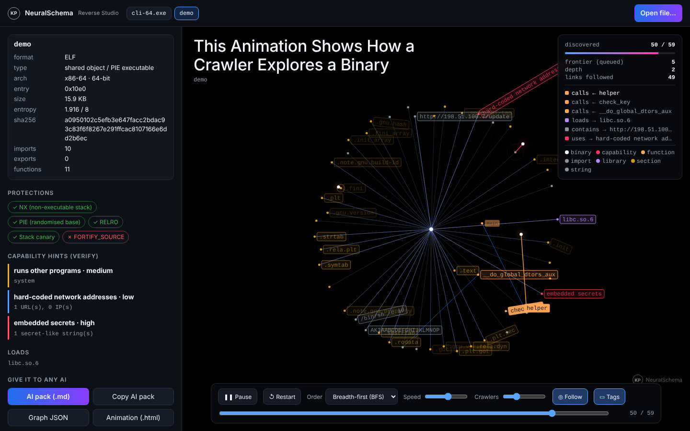

# Reverse Mode, Reverse Studio and the MCP server

NeuralSchema 0.3 can open things that have **no source code** and map them
the same way it maps code: programs, libraries, apps, WebAssembly and AI model
files. It gives you two front doors. Humans can **drag and drop** files into
the Studio. Any AI agent can **call tools** through MCP.



> Only analyse files you own or are allowed to analyse: your own builds,
> coursework, malware samples inside a safe lab, or software whose licence
> permits reverse engineering. Analysis is **static**. Nothing is ever
> executed.

## Quick start

```bash
# 1. Drag-and-drop Studio in your browser (local only)
python3 neural_schema.py --serve

# 2. One file from the terminal: evidence pack for any AI + animation
python3 neural_schema.py --file app.exe --export aipack crawl json --out ./out/ --no-gui

# 3. Let an AI agent use it (MCP over stdio)
claude mcp add neuralschema -- python3 /full/path/neural_schema.py --mcp
```

## What it reads

| Input | What you get |
|---|---|
| Windows `.exe` `.dll` `.sys` (PE32/PE32+) | Arch, subsystem, compile time, sections and entropy, DLL imports, exports, **imphash**, ASLR/DEP/CFG/signature, packer hints (UPX, Themida...), overlay, .NET marker |
| Linux ELF programs and `.so` | Arch, type, interpreter, sections, needed `.so` libraries, imported and exported symbols, NX/PIE/RELRO/canary/FORTIFY, Go marker |
| macOS / iOS Mach-O (thin and universal) | CPU, type, segments and sections, linked dylibs, symbols, PIE, code-signature, FairPlay encryption |
| `.apk` `.jar` `.aar` `.ipa` `.whl` `.zip` / Office files | Package type, manifest facts, folders, DEX files. Embedded native libraries are analysed too. |
| `.wasm` | Sections, host imports (`env.log`...), exports, function count |
| `.gguf` / `.safetensors` | Architecture, metadata, every tensor's shape and dtype, total parameter count |
| Anything else | Entropy plus interesting strings |
| Source code | The existing code analyzers (unchanged) |

**Every format** also gets:
- **Interesting strings**: URLs, IPs, emails, paths, registry keys, shells, crypto words, and secrets matched by the same patterns as the code scanner.
- **Capability hints**: import-based triage such as "process injection", "keyboard capture", "downloads from the internet" or "packed code", each with the evidence that triggered it. These are hints to verify, never a verdict.
- **Call graph and disassembly** via `objdump`, if it is installed. Stripped binaries get IDA-style **function recovery** (`sub_<address>`), and Windows calls through the import table are named (`CreateProcessA`).

## The AI pack (works with *any* AI)

`--export aipack` (or the Studio's **AI pack** button) writes one Markdown
file: identity, protections, capability hints, imports grouped by library,
exports, call graph, disassembly excerpts, strings, model tensors, archive
contents and a list of good questions to ask. Paste or upload it into Claude,
ChatGPT, Gemini, or a local model.

Prompt-injection safety: everything quoted from the file sits inside code
fences, labelled as untrusted data. Backticks from the file are neutralised,
so a hostile string cannot close the fence and talk to the AI.

## Reverse Studio (drag and drop)

`python3 neural_schema.py --serve` opens `http://127.0.0.1:8765/`. Drop one or
more files anywhere on the window, or use **Open file…**. For each file you get:

- the **Crawl Mode animation** of its structure (binary → sections → functions → calls / imports → capabilities),
- the evidence panel (identity, protection chips, capability hints, loaded libraries, notes),
- downloads: AI pack (.md), graph JSON, and the animation as a standalone .html,
- **Ask local AI**: sends the AI pack plus your question to Ollama (`OLLAMA_HOST`, default `127.0.0.1:11434`). It runs fully offline.

The desktop GUI also accepts drops if `pip install tkinterdnd2` is present,
and its **AI pack** button writes the same file.

### Security design

| Risk | Defence |
|---|---|
| Other computers reaching the Studio | Binds to `127.0.0.1` only |
| A malicious website in another tab POSTing files (CSRF) | A random per-run token is required on every API call |
| DNS-rebinding | The `Host` header must be `127.0.0.1:<port>` or `localhost:<port>` |
| Path traversal in the dropped file name | Basename only; printable characters only |
| Disk leftovers | Upload goes to a private temp folder and is deleted after analysis |
| Hostile labels in the animation | Data is `\u`-escaped inside the page. The page runs in an `allow-scripts`-only sandboxed iframe with an opaque origin and no access to the token. |
| Huge uploads | 300 MB limit (413), and binaries larger than 512 MB are refused |
| Malformed files | Every read is bounds-checked; a fuzz test runs thousands of corrupted files |

## MCP server: let any AI agent reverse things

`python3 neural_schema.py --mcp` speaks the Model Context Protocol over stdio.
It has no dependencies. Logs go to stderr, and stdout is the protocol channel.

| Tool | What it does |
|---|---|
| `reverse_file` | The full evidence pack (binaries) or architecture pack (source) |
| `list_functions` | Functions (named or recovered) with size and callees, filterable |
| `disassemble` | One function's disassembly |
| `callers` | Cross-references: who calls `system` / `CreateRemoteThread` / `check_key` |
| `find_strings` | Strings filtered by regex (returned as untrusted data) |
| `analyze_code` | Static-analysis report for source files and folders |
| `crawl_animation` | Writes the animated page and returns its path |

Register it (use the **full path** to `neural_schema.py`):

```bash
# Claude Code
claude mcp add neuralschema -- python3 /full/path/neural_schema.py --mcp
```

```json
// Claude Desktop: claude_desktop_config.json
{ "mcpServers": { "neuralschema": {
    "command": "python3", "args": ["/full/path/neural_schema.py", "--mcp"] } } }
```

```json
// OpenCode: opencode.json
{ "$schema": "https://opencode.ai/config.json",
  "mcp": { "neuralschema": { "type": "local", "enabled": true,
    "command": ["python3", "/full/path/neural_schema.py", "--mcp"] } } }
```

Then ask the agent things like: *"Use neuralschema to reverse
~/Downloads/tool.exe. What does it do, and is anything suspicious?"*

### Pairing with REA

[REA — Reverse Engineer Anything](https://github.com/morluto/rea) (MIT; your
fork is `Kanak234/rea`) is a large Node.js MCP server. It drives Ghidra, IDA,
Hopper, JADX, Frida and more for *deep* decompilation. NeuralSchema is the
light, dependency-free first pass and visual map.

Register both MCP servers in the same agent:
1. The agent triages with `neuralschema.reverse_file`.
2. It then asks REA for decompiled pseudocode of the functions that matter.

NeuralSchema does not copy REA's code. It follows the same idea of giving
the AI evidence instead of guesses, written independently in Python.

## Design notes (TRD)

- **One evidence dict.** Every parser fills the same `info` dict. Three consumers read it: `_info_to_graph()` (GUI, exporters, animation), `ai_pack_markdown()` (any AI) and the MCP tools.
- **Single file, standard library only.** objdump, Ollama and tkinterdnd2 are optional. Each one only switches on its own feature.
- **Caps instead of crashes.** Graphs keep at most 700 imports, 900 functions, 150 strings and 1,500 tensors. Whatever was cut is recorded on the root node as `truncated`.
- **objdump parsing.**
  - Function starts are labels, plus direct call targets, plus the entry point.
  - Each instruction is assigned to the nearest preceding start (bisect).
  - PLT stubs are dropped.
  - IAT slots come from the PE import table.

## Worst case → behaviour

| Situation | Behaviour |
|---|---|
| Truncated / corrupted / deliberately malformed file | Parser stops and the note says where; everything parsed so far is kept |
| Packed malware (UPX, Themida) | Packer and high-entropy executable section are reported; unpack before deeper work |
| Stripped release build | Functions are recovered as `sub_XXXX`; Windows API calls are still named |
| No objdump (e.g. plain Windows) | Everything except disassembly and call graph works; a note explains how to enable it |
| Zip bomb | An extreme compression ratio is detected and nested extraction is skipped |
| 5 GB model file | Refused above 512 MB. Model inspection of large GGUF files is a known limit (see below). |
| Ollama not running | The Studio says so; the AI pack still works with any cloud AI |
| A binary whose strings try to instruct the AI | The strings are fenced, labelled untrusted, and backticks neutralised |

## Victory path

- A demo GIF of dropping a known open-source `.exe` into the Studio, then the crawl animation, then "Ask local AI", for the README and a *Cooding with Kanak* Short.
- Show the MCP flow in OpenCode with a local model: a fully offline AI reverse-engineering assistant.

## Known limits

- **Models.** GGUF/safetensors files are read fully into memory. Very large models need a streaming header reader (planned).
- **Disassembly needs a matching objdump.** Typical Linux binutils handle x86 ELF and PE. Mach-O disassembly may need `llvm-objdump`.
- **Static only.** Code that unpacks itself at runtime is not followed. Use a sandbox and debugger, or REA's runtime tools.
- **GUI drop not run in CI.** The drop handler in the Tk GUI was not exercised in CI (no display / tkinter there).
